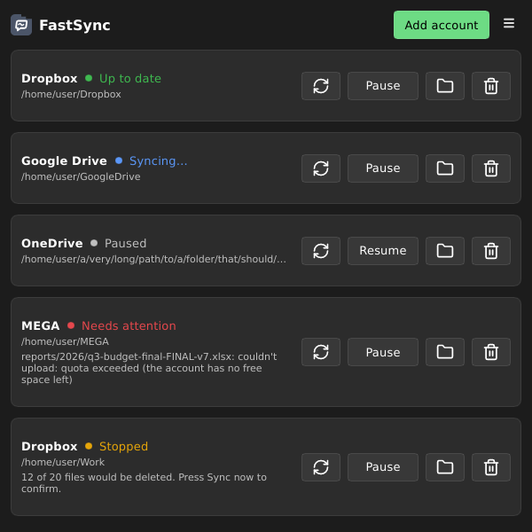

#  FastSync

[](https://github.com/evandro777/FastSync/actions/workflows/ci.yml)
[](https://github.com/evandro777/FastSync/actions/workflows/flatpak.yml)
[](https://github.com/evandro777/FastSync/actions/workflows/appimage.yml)
[](https://github.com/evandro777/FastSync/actions/workflows/virustotal.yml)
[](https://www.linux.org/)
[](https://opensource.org/licenses/GPL-3.0)

Two-way folder sync for Dropbox, Google Drive, OneDrive and MEGA, built with Rust + [Slint](https://slint.dev) (software renderer, no GL). Pick a folder, log in, and its files stay in sync both ways and available offline. It owns the sync logic (what changed, what to upload, download or delete) and uses [rclone](https://rclone.org) only to log in and move the bytes.

Page: <https://evandro777.github.io/FastSync/>



## Disclaimer

> [!WARNING]
> This is an early version. It works, but it is not yet polished and may have bugs. Please back up your files before using it.

## Features

- **Accounts:** Add account, pick the service, a local folder and (optionally) a folder inside the cloud, and log in in your browser. MEGA asks for its email and password instead. Several accounts run at once.
- **Your own client ID (recommended):** rclone's built-in login ID is shared by all its users, so the service's rate limit can stop syncing for a while (Google has said the shared Drive ID will stop working during 2026). Tick "Use my own client ID" in Add account and paste an ID of your own: a free, 10-minute setup, explained step by step in [docs/OWN-CLIENT-ID.md](docs/OWN-CLIENT-ID.md) (the dialog has a "How to get one" button).
- **Fast change detection:** edits on your computer are seen at once (inotify). Edits in the cloud come from the service's own change feed (Dropbox long-poll, Google Drive changes, OneDrive delta), so the whole tree is not listed again. MEGA and other services are listed in full every 5 minutes.
- **Two-way, offline:** every file is kept on disk. If both sides changed a file, both copies are kept (`name (conflict 2026-11-11).ext`).
- **Safe by design:** a file removed in the cloud goes to `.fastsync/trash` in your folder, never straight to oblivion, and only if FastSync had synced it before. A run that would delete more than half of your files (once there are 10 or more) is stopped until you press Sync now. Downloads are written to a temp file and renamed, so a crash never leaves a half file.
- **Tray:** the window hides to the tray when closed. The tray shows the overall status and has Open, Sync now, Pause and Quit. Without a tray host, closing the window quits.
- Preferences: Appearance (System, Light or Dark) and Language (System, English or Português), both remembered.

Not in this version: online-only (on-demand) files, selective sync of subfolders, file manager overlay icons, share links, empty folders, detection of renames (a rename is an upload plus a delete), Google Docs/Sheets and Dropbox Paper docs (`.paper`): they have no file content, so they are skipped.

## Install

### Flatpak

#### Install from file (no updates)

A `.flatpak` file downloaded from Releases is a one-off install (will not auto update). To get automatic updates, go to [Install with automatic updates](<#Install with automatic updates>).

Download `FastSync-<version>-x86_64.flatpak` from [Releases](https://github.com/evandro777/FastSync/releases), then execute:

```bash
flatpak install --user ~/Downloads/FastSync-<version>-x86_64.flatpak
```

#### Install with automatic updates

This app is not in Flathub yet. You need to add this repository as a remote. Every release is also published as a Flatpak remote, so `flatpak update` (or your software centre) keeps the app updated.

```bash
flatpak remote-add --system --if-not-exists fastsync https://evandro777.github.io/FastSync/fastsync.flatpakrepo
flatpak install --system fastsync io.github.evandro777.FastSync
```

**`--system` vs `--user` matters for updates.** Linux Mint's Update Manager (and probably other software centres) only looks at *system-wide* Flatpaks; With `--user`, update by hand: `flatpak update --user`.

The remote is GPG-signed (system-wide installs refuse unsigned remotes), but the key lives in this same repository. It needs the Flathub remote for the runtime (`flatpak remote-add --if-not-exists flathub https://dl.flathub.org/repo/flathub.flatpakrepo`, with `--system` or `--user` to match).

### AppImage (with delta updates)

Download `FastSync-<version>-x86_64.AppImage` from [Releases](https://github.com/evandro777/FastSync/releases), then execute:

```bash
sudo chmod +x ~/Downloads/FastSync-<version>-x86_64.AppImage
~/Downloads/FastSync-<version>-x86_64.AppImage
```

It uses the fontconfig, xkbcommon and X11 libraries already on your system, and it needs `rclone` installed. Use the official build from [rclone.org](https://rclone.org/install/): Debian and Ubuntu's `apt` package is old and leaves out some services (MEGA, for one). The Flatpak bundles the official one.

The AppImage does not update itself, but it has update information built in, so a tool such as [AppImageUpdate](https://github.com/AppImageCommunity/AppImageUpdate) (`appimageupdatetool FastSync-*.AppImage`), [Gear Lever](https://github.com/mijorus/gearlever) or [AppManager](https://github.com/kem-a/AppManager) downloads only the changed parts of the next release.

## Build & Configurations

[Build and configurations information](BUILD.md)

## Contributing and releases

See [`CONTRIBUTING.md`](CONTRIBUTING.md) to build, test and send a change, and [`RELEASING.md`](RELEASING.md) for how a release is cut. CI (format, clippy, tests, MSRV, packaging checks, and the AppImage and Flatpak builds) runs on every pull request.

## License

GPL-3.0-or-later. See [`LICENSE`](LICENSE).
