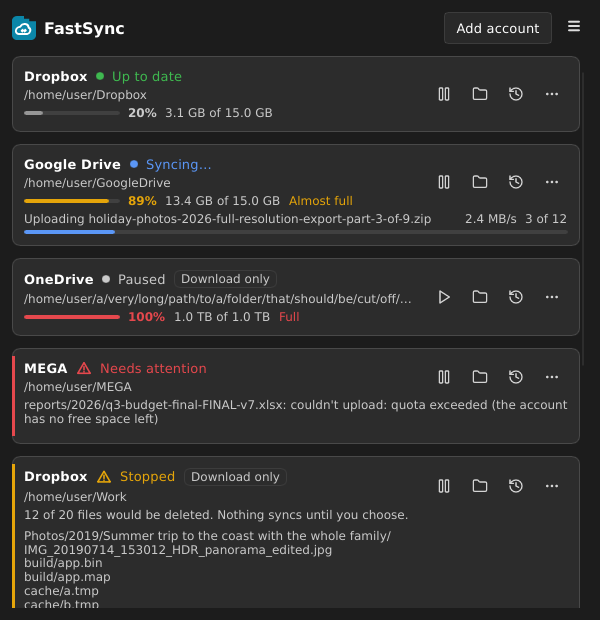

#  FastSync

[](https://github.com/evandro777/FastSync/actions/workflows/ci.yml)
[](https://github.com/evandro777/FastSync/actions/workflows/flatpak.yml)
[](https://github.com/evandro777/FastSync/actions/workflows/appimage.yml)
[](https://github.com/evandro777/FastSync/actions/workflows/virustotal.yml)
[](https://www.linux.org/)
[](https://opensource.org/licenses/GPL-3.0)

Two-way folder sync for Dropbox, Google Drive, OneDrive and MEGA, built with Rust + [Slint](https://slint.dev) (software renderer, no GL). Pick a folder, log in, and its files stay in sync both ways and available offline. It owns the sync logic (what changed, what to upload, download or delete) and uses [rclone](https://rclone.org) only to log in and move the bytes.

Page: <https://evandro777.github.io/FastSync/>



## Disclaimer

> [!WARNING]
> This is an early version. It works, but it is not yet polished and may have bugs. Please back up your files before using it.

## Features

- **Accounts:** Add account, pick the service and a local folder, and log in in your browser. MEGA asks for its email and password instead. Several accounts run at once. The pencil button on a card edits the account: its local folder, its folders and its login. There is no separate login button: **Next** signs in again in your browser by itself when you changed the client ID or when the saved login has expired or was revoked (MEGA: when you type the password). Sign in with the same account as before; the old login is kept unless the new one works.
- **Selective sync:** once the connection works, a list of your cloud folders opens. Untick the ones you do not want on this computer (open a folder with its arrow to choose inside it). New folders sync by default. Unticking a folder that was already synced moves its local copy to `.fastsync/trash` and leaves the cloud copy alone; a file you edited since the last sync stays where it is. If you cancel the list, a new account is kept paused until you press Resume. Changing the local folder of an account starts that folder from scratch: it is merged with the cloud, nothing is deleted.
- **Your own client ID (recommended):** rclone's built-in login ID is shared by all its users, so the service's rate limit can stop syncing for a while (Google has said the shared Drive ID will stop working during 2026). Tick "Use my own client ID" in Add account and paste an ID of your own: a free, 10-minute setup, explained step by step in [docs/OWN-CLIENT-ID.md](docs/OWN-CLIENT-ID.md) (the dialog has a "How to get one" button).
- **Fast change detection:** edits on your computer are seen at once (inotify). Edits in the cloud come from the service's own change feed (Dropbox long-poll, Google Drive changes, OneDrive delta), so the whole tree is not listed again. MEGA and other services are listed in full every 5 minutes. If the system's inotify watch limit is too low for your folders, Preferences shows the command that raises it; until then a check every 2 minutes catches what was missed.
- **Two-way, offline:** every file is kept on disk. If both sides changed a file, both copies are kept (`name (conflict 2026-11-11).ext`, the date is UTC), it is written to the activity log, and once syncing has been quiet for 10 seconds you get one desktop notification (that stays until dismissed) naming the first file and how many there were, however many files conflicted (clicking it opens the activity log on Problems; with a single conflict it also has a "Show file" button that opens your file manager with the file selected), unless the service's own checksum shows they are the same bytes (Drive, Dropbox, OneDrive; not MEGA, which offers no checksum, so there a file with a different modified time is always kept twice, even if it is identical): then nothing is copied or renamed. The same applies when you add an account on a folder that already has files (a fresh install, or after removing an account): nothing is downloaded again; files that match are only noted, the ones only on your computer go up, the ones only in the cloud come down. An empty file in the cloud (what quitting in the middle of an upload can leave behind) is filled with your local file, never turned into a conflict.
- **Cloud space:** each card shows a small gauge of your cloud storage with the percentage and the sizes ("20% 3.1 GB of 15.0 GB", refreshed every 15 minutes). It turns amber and says "Almost full" from 80 %, and red from 95 % ("Full" at 100 %), so a full cloud is noticed before uploads start failing. Nothing is shown when the service reports no limit.
- **Renames and moves:** a file or folder renamed on one side is renamed on the other (a server-side move in the cloud, a plain rename here) instead of being sent again, so renaming a big folder costs almost nothing. FastSync only does this when the service's own file hash proves the bytes are the same; otherwise it falls back to copy and delete. The activity log shows these as "Moved". A cloud folder that a move or a delete leaves empty is removed too, so no empty copy of the old folder stays behind. Google Drive shortcuts (links) are not synced: they stay in Drive, so a shortcut never becomes a second copy of its folder on disk.
- **Many files at once:** uploads and downloads run four at a time. Before them, FastSync has to ask the cloud about every changed file, and one request per file is slow (dropping 84 empty files in a folder took 30 to 60 seconds before the first upload, depending on the service). So when several files changed in the same folder, it asks for that folder's listing once instead (a single request for hundreds of files), and it only asks file by file for a lone change, or when the listing fails. A folder deleted in the cloud is confirmed with one extra request about the folder itself, not one per file, and the 50% delete guard still decides whether to go ahead. Not measured against every service yet.
- **Duplicates made in the cloud:** when a new cloud file of 1 MiB or more has exactly the bytes of a file you already have on disk (for example you duplicated it on the website), FastSync copies your local file instead of downloading it again. It does this only when the service's own file hash proves the bytes are the same, and the original stays untouched. If your original changes while it is copied, or anything else is in doubt, it downloads the file as usual. The activity log shows it as a normal download. Not on MEGA, which has no file hash. A file duplicated on your computer is still uploaded in full.
- **Native client files are never synced:** `.dropbox`, `.dropbox.cache`, `.dropbox.attr`, Google Drive's `.tmp.drive*`, MEGA's `.debris`, Office lock files (`~$*`) and OS leftovers (`.DS_Store`, `Thumbs.db`, `Desktop.ini`), so a folder the official Dropbox client used can be reused (one client at a time).
- **Ignore rules:** put a file named `rules.fastsyncignore` in the root of a synced folder, with [gitignore](https://git-scm.com/docs/gitignore) rules (one per line, `#` comments, `*`, `?`, `[a-z]`, `**`, `!` to re-include, a trailing `/` for folders, a leading `/` for the root), for example `*.log`, `build/` or `docs/**/*.tmp`. Matching files are never uploaded or downloaded. The file syncs like any other, so all your computers share the rules, and a change takes effect within seconds. Like Dropbox's `rules.dropboxignore`: a file already synced that a rule now matches **is deleted from the cloud** (your local copy stays, and it goes back up if you remove the rule); files that only exist in the cloud are left there. The 50% delete guard applies, so a rule such as `*` stops and asks first. Not supported: escaped trailing spaces, ignore files in sub-folders.
- **Download only (one-way):** tick it in Add/Edit account to make the folder an exact mirror of the cloud, which is never changed. Edits you make there are replaced by the cloud copy, files you add or delete locally are moved to `.fastsync/trash` (a deleted file comes back), all within seconds. The same 50% delete guard applies, so pointing a new account at a folder full of your own files stops and asks first. Unticking it later returns to two-way sync.
- **Safe by design:** a file removed in the cloud goes to `.fastsync/trash` in your folder, never straight to oblivion, and only if FastSync had synced it before. Items older than 90 days are deleted from the trash automatically (a background thread checks at start-up and every 6 hours); change the number of days in Settings, where 0 keeps them forever. Removing an account deletes its trash items older than that limit once and leaves the rest in `.fastsync/trash` (nothing counts or ages it afterwards: delete it by hand). If the bundled `rclone` process ever dies, FastSync starts it again by itself. Settings also shows how much has piled up across your accounts and **Empty…** deletes it all at once, after a confirmation. A run that would delete more than half of your files (once there are 10 or more) is stopped, and the account then **waits for you**: it syncs nothing, not even after a restart, until you choose on its card. **Restore** copies the files back to the side they vanished from (a folder deleted in the cloud goes back up, files you deleted here come back down); **Delete them** goes ahead, but never with more files than the card named (if more went missing meanwhile it stops again and asks again). A download-only account offers only **Delete them**. When it stops, the card turns amber and names the first few files, the tray says "Deletions waiting for your confirmation", and you get one desktop notification (not one per scan; a clean run re-arms it, and a restart notifies again while the account is still waiting). Downloads are written to a temp file and renamed, so a crash never leaves a half file.
- **What is syncing:** while an account syncs, its card names the file being uploaded, downloaded or removed, shows "3 of 12" with a thin bar, and the current transfer speed (from rclone, per account). A scan that has found nothing to do yet shows only "Syncing…".
- **Activity log:** the clock button on a card opens what that account did lately: files sent, received and removed (with size and when), conflicts, every problem with its full message, and when the delete guard stopped a run, with its counts. The top shows when the last file synced and the last problem. Tabs filter All, Files and Problems (conflicts show in both Files and Problems, each with a folder button that shows the file in your file manager); **Copy log** puts the list (UTC times) on the clipboard for a bug report. It is kept per account, 30 days and at most 2000 entries; older ones are removed automatically. Runs that find nothing to do are not logged.
- **Pause:** stops a sync that is running, too: the files being copied at that moment finish, no new one starts, and Resume compares everything again.
- **Tray:** the window hides to the tray when closed. The tray shows the overall status and has Open, Sync now, Pause and Quit. Without a tray host, closing the window quits.
- **Nemo menu:** right-click a synced file or folder in Nemo and open the **FastSync** submenu. It appears only inside your synced folders.
    - **Copy share link:** FastSync asks the provider for a public link (Dropbox, Google Drive, OneDrive, MEGA) and shows it with a Copy button. The file must already be in the cloud.
    - **View on web:** opens the file's page on the provider's website (MEGA opens the folder that holds it), where its own Share button lets you invite people. If the page cannot be found, the provider's home page opens.
    - FastSync keeps the actions in `~/.local/share/nemo/actions` and adds the submenu to your `~/.config/nemo/actions-tree.json` (the Actions layout editor's file; your other entries are kept, and a copy of the original is saved once as `actions-tree.json.fastsync.bak`). Both follow your accounts. Restart Nemo with `nemo -q` after the first install, or when the menu does not show. You can move or rename the FastSync submenu in the layout editor.
    - Not in the Flatpak (it cannot write there): copy the files from a regular install or make an action yourself with `Exec=flatpak run io.github.evandro777.FastSync --share %F` (or `--web %F`). Nemo only; no revoking of links (use the provider's website).
- **File manager emblem:** each account's local folder gets FastSync's own round badge (check, arrows, pause bars or "!", in the tray's colours) in Nemo, Nautilus and Caja. Only the folder, not each file, and not inside the Flatpak. Turn it off with "File manager emblems" in Preferences.
- Preferences: Appearance (System, Light or Dark) and Language (System, English or Português), both remembered. Also two intervals for the full local check that catches edits the file watcher missed (1 to 60 minutes): every 5 minutes by default while your folders are watched, and every 2 minutes when they cannot be (the system's watch limit is reached, or watching could not start). A longer time saves disk work on very large folders.

Not in this version: online-only (on-demand) files, file manager overlay icons, share links, empty folders, rename detection and local copies of cloud duplicates on MEGA (it has no file hash, so a rename there is an upload plus a delete, and a duplicate is downloaded), Google Docs/Sheets and Dropbox Paper docs (`.paper`): they have no file content, so they are skipped.

## Install

### Flatpak

#### Install from file (no updates)

A `.flatpak` file downloaded from Releases is a one-off install (will not auto update). To get automatic updates, go to [Install with automatic updates](<#Install with automatic updates>).

Download `FastSync-<version>-x86_64.flatpak` from [Releases](https://github.com/evandro777/FastSync/releases), then execute:

```bash
flatpak install --user ~/Downloads/FastSync-<version>-x86_64.flatpak
```

#### Install with automatic updates

This app is not in Flathub yet. You need to add this repository as a remote. Every release is also published as a Flatpak remote, so `flatpak update` (or your software centre) keeps the app updated.

```bash
flatpak remote-add --system --if-not-exists fastsync https://evandro777.github.io/FastSync/fastsync.flatpakrepo
flatpak install --system fastsync io.github.evandro777.FastSync
```

**`--system` vs `--user` matters for updates.** Linux Mint's Update Manager (and probably other software centres) only looks at *system-wide* Flatpaks; With `--user`, update by hand: `flatpak update --user`.

The remote is GPG-signed (system-wide installs refuse unsigned remotes), but the key lives in this same repository. It needs the Flathub remote for the runtime (`flatpak remote-add --if-not-exists flathub https://dl.flathub.org/repo/flathub.flatpakrepo`, with `--system` or `--user` to match).

### AppImage (with delta updates)

Download `FastSync-<version>-x86_64.AppImage` from [Releases](https://github.com/evandro777/FastSync/releases), then execute:

```bash
sudo chmod +x ~/Downloads/FastSync-<version>-x86_64.AppImage
~/Downloads/FastSync-<version>-x86_64.AppImage
```

It uses the fontconfig, xkbcommon and X11 libraries already on your system, and it needs `rclone` installed. Use the official build from [rclone.org](https://rclone.org/install/): Debian and Ubuntu's `apt` package is old and leaves out some services (MEGA, for one). The Flatpak bundles the official one.

The AppImage does not update itself, but it has update information built in, so a tool such as [AppImageUpdate](https://github.com/AppImageCommunity/AppImageUpdate) (`appimageupdatetool FastSync-*.AppImage`), [Gear Lever](https://github.com/mijorus/gearlever) or [AppManager](https://github.com/kem-a/AppManager) downloads only the changed parts of the next release.

## Build & Configurations

[Build and configurations information](BUILD.md)

## Contributing and releases

See [`CONTRIBUTING.md`](CONTRIBUTING.md) to build, test and send a change, and [`RELEASING.md`](RELEASING.md) for how a release is cut. CI (format, clippy, tests, MSRV, packaging checks, and the AppImage and Flatpak builds) runs on every pull request.

## License

GPL-3.0-or-later. See [`LICENSE`](LICENSE).

The Flatpak also contains the unmodified official [rclone](https://rclone.org) binary, which is MIT licensed (copyright Nick Craig-Wood and contributors; source and licence at <https://github.com/rclone/rclone>).
